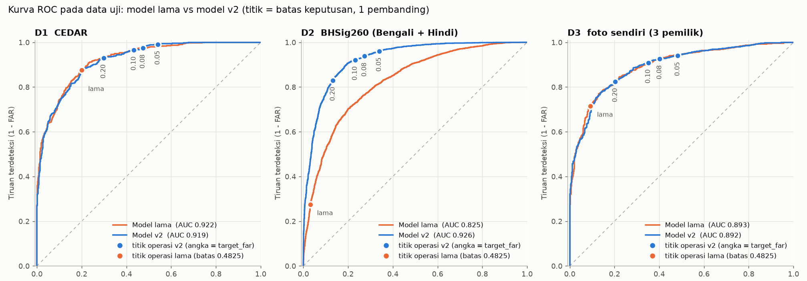
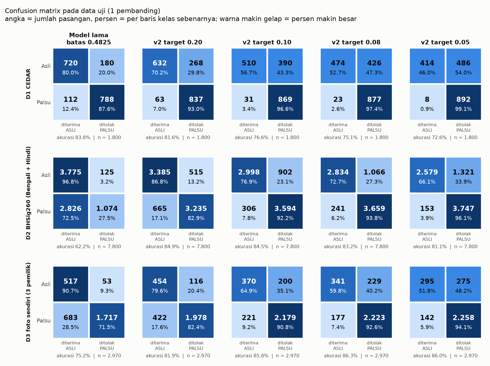

# SignaCheck ✍️ — Sistem Verifikasi Keaslian Tanda Tangan

> **Mata Kuliah:** Visual Komputasi Cerdas (Smart Computer Vision)  
> **Arsitektur:** Siamese Convolutional Neural Network (CNN) + Ekstraksi Ciri Morfologi Klasik  
> **Pendekatan:** *Writer-Independent* (Dapat mengevaluasi tanda tangan orang baru tanpa perlu melatih ulang model)  
> **Model aktif:** **v2** (ensemble, dilatih dengan CEDAR + BHSig260), titik operasi aktif **target_far 0.08**  
> ⚠️ **Catatan Akademik:** Sistem ini adalah **prototipe riset**, menghasilkan **indikasi pendukung, bukan alat bukti hukum**.

---

## 🚀 Panduan Cepat Menjalankan Aplikasi (Untuk Teman Kelompok)

Hanya perlu **3 Langkah Mudah** untuk menjalankan proyek ini di laptop masing-masing:

### Langkah 1: Pastikan Prasyarat Sudah Terpasang
- **Python 3.10+** (Centang *"Add Python to PATH"* saat instalasi).
- **Node.js 18+** atau **Bun** (untuk menjalankan antarmuka web).

### Langkah 2: Install Dependensi (Cukup Sekali Saja)
Buka terminal (Command Prompt / PowerShell) di folder proyek ini:

1. **Install Library Backend (Python):**
   ```bash
   pip install -r requirements.txt
   ```
2. **Install Library Frontend (Web):**
   ```bash
   cd "frontend v2"
   npm install
   ```
   *(Atau gunakan perintah `bun install` jika kamu menggunakan Bun).*

### Langkah 3: Jalankan Aplikasi Sekali Klik!
Cukup **klik dua kali (double-click)** file:
```text
⚡ jalankan_semua.bat
```
File ini secara otomatis akan:
1. Menyalakan server **Backend FastAPI** di `http://127.0.0.1:8000`.
2. Menyalakan web **Frontend React Vite** di `http://localhost:5173`.
3. Membuka browser kamu secara otomatis ke halaman aplikasi.

*(Untuk mematikan aplikasi, cukup tutup kedua jendela Command Prompt yang terbuka).*

> **Setelah mengganti config atau model, backend harus dijalankan ulang** (tutup jendela backend, klik `jalankan_semua.bat` lagi).
> Backend yang masih terbuka dari sebelumnya tetap memakai config lama.

---

## 🎯 Panduan Praktis Saat Demo & Presentasi

### 1. Gunakan Fitur "Contoh Siap Pakai"
Di halaman **Periksa Tanda Tangan** ada 5 contoh. Hasil nyata model v2 (1 pembanding, diukur lewat backend):

| Contoh | Seharusnya | target 0.20 | target 0.10 | target 0.08 (aktif) | target 0.05 | Jarak |
| :--- | :--- | :--- | :--- | :--- | :--- | :--- |
| 1. Pemilik 1: asli vs asli | ASLI | ASLI | ASLI | **BELUM YAKIN** | BELUM YAKIN | 0.269 |
| 2. Pemilik 2: asli vs asli | ASLI | PALSU | PALSU | PALSU | PALSU | 0.544 |
| 3. Pemilik 1: asli vs tiruan mahir | PALSU | PALSU | PALSU | PALSU | PALSU | 1.066 |
| 4. Pemilik 2: asli vs tiruan mahir | PALSU | PALSU | PALSU | PALSU | PALSU | 0.778 |
| 5. Pemilik 3: asli vs tiruan mahir | PALSU | PALSU | PALSU | PALSU | PALSU | 0.636 |

Yang perlu diketahui sebelum presentasi:
- **Contoh 2 salah (asli dinilai PALSU) di semua target.** Pemilik 2 memang sering menulis berbeda antar-sesi; ini contoh nyata
  keterbatasan, bukan galat program. Jelaskan jujur, atau tambahkan pembanding (lebih andal).
- **Contoh 1 menjadi BELUM YAKIN pada target 0.08 dan 0.05** karena Uji Goyang menilai keputusannya tidak stabil (jarak 0.269 cukup dekat dengan batas).
  Pada target 0.20 dan 0.10 hasilnya ASLI. Bila ingin demo "asli -> ASLI" yang mulus, pakai config 0.20 atau 0.10 (lihat bagian 4 di bawah).
- Setelah hasil keluar, sistem menampilkan label **Ground Truth** untuk membuktikan kebenaran deteksi.

### 2. Jika Menguji Tanda Tangan Baru (Live Test)
- Selalu masukkan **minimal 2 sampai 3 tanda tangan asli** di kolom referensi/pembanding untuk mengantisipasi variasi alami tanda tangan manusia (*intra-writer variability*).
- Masukkan **1 tanda tangan yang mau diperiksa** di kolom tanda tangan uji.
- Klik **"Periksa Tanda Tangan"**.

### 3. Cara Membaca Output Sistem
Skor model v2 adalah **jarak terdekat** ke salah satu pembanding (bukan rata-rata). Batas keputusan bergantung pada jumlah pembanding (tabel di bawah).
- **Hijau (ASLI):** jarak terdekat <= batas **dan** Uji Goyang stabil **dan** ciri forensik sepakat dengan model **dan** pembanding konsisten **dan** bukan salinan persis. ASLI sengaja sulit didapat agar tanda tangan palsu tidak lolos.
- **Kuning (BELUM YAKIN):** salah satu pemeriksaan tidak lolos: Uji Goyang menilai keputusan tidak stabil (jarak dekat dengan batas, bisa condong ASLI maupun PALSU), model menilai ASLI tetapi ciri forensik berbeda, salinan persis, atau pembanding tidak konsisten. Tambah pembanding atau minta tinjauan manusia.
- **Merah (PALSU / BERBEDA):** jarak terdekat > batas dan keputusan stabil.
- **Tabel 8 Ciri Morfologi:** Menampilkan penjelasan pendamping bentuk fisik (luas area, keliling, kerapatan, aspek rasio, kemiringan sudut, dll.).

### 4. Menjalankan model dengan target_far 0.20 / 0.10 / 0.08 / 0.05 (secara mandiri)
Empat config tersimpan di `demo_model_files_v2/` (model `.keras` sama, hanya batas yang berbeda). `config.json` adalah yang **sedang dipakai** backend.

| Target | File config | Batas 1 pembanding | Sifat |
| :--- | :--- | :--- | :--- |
| 0.20 | `config_target_far_0.20.json` | 0.4302 | Paling longgar: paling banyak asli diterima, paling banyak tiruan lolos |
| 0.10 | `config_target_far_0.10.json` | 0.3570 | Menengah-longgar |
| 0.08 | `config_target_far_0.08.json` | 0.3369 | **Aktif saat ini** (sama dengan `config.json`) |
| 0.05 | `config_target_far_0.05.json` | 0.3095 | Paling ketat: tiruan hampir tidak lolos, tetapi banyak asli menjadi BELUM YAKIN/PALSU |

#### A. Berpindah target (±1 menit, tanpa dataset)
1. **Tutup jendela "SignaCheck Backend"** bila sedang berjalan. (Backend hanya membaca config saat dinyalakan.)
2. **Pilih target**, salah satu cara:
   - Dengan skrip (paling mudah). Buka terminal di folder proyek:
     ```bat
     ganti_target_far.bat 0.05
     ```
     Ganti `0.05` dengan `0.20`, `0.10`, `0.08`, atau `0.05`. Skrip menampilkan batas yang aktif dan memberi peringatan bila backend masih berjalan.
   - Atau manual (CMD): `copy /Y "demo_model_files_v2\config_target_far_0.05.json" "demo_model_files_v2\config.json"`
     (PowerShell: `Copy-Item "demo_model_files_v2\config_target_far_0.05.json" "demo_model_files_v2\config.json" -Force`).
3. **Nyalakan backend**: klik dua kali `jalankan_semua.bat`.
4. **Pastikan config yang dipakai benar**: buka `http://127.0.0.1:8000/api/model-info` di browser. Nilai `threshold` harus
   sesuai target (0.20 → 0.4302, 0.10 → 0.3570, 0.08 → 0.3369, 0.05 → 0.3095). Log jendela backend juga mencetak `threshold` saat start.
5. *(Opsional)* Uji otomatis, dengan backend menyala, di terminal lain: `python scripts/test_system.py`. Baris terakhir harus
   `RINGKASAN: lulus 20 dari 20 uji`.

#### B. Mengukur sendiri hasilnya pada foto Anda (±2-3 menit per target)
Dengan backend menyala pada target yang dipilih:
```bat
python scripts\uji_foto_sendiri_status.py
```
Skrip menguji 3 pemilik di `ttd_uji_sendiri/` (45 tiruan, 24 asli) untuk 1, 3, dan 5 pembanding, dan mencetak jumlah **ASLI / BELUM YAKIN / PALSU**.
Hasilnya harus sama dengan tabel "Foto sendiri lewat backend nyata" di atas. Opsi: `--k 1 2 3` (jumlah pembanding), `--port 8011`, `--out hasil.csv` (rincian per gambar).
Ulangi langkah A lalu B untuk tiap target bila ingin membandingkan keempatnya.

#### C. Membuat ulang config dari awal (cache ±16 menit sekali, lalu ±8 menit per target; perlu dataset)
Hanya perlu bila ingin membuktikan bahwa config bisa direproduksi, atau memakai target lain (mis. 0.15).
Prasyarat: dataset di folder `Dataset_Project` (berisi `CEDAR/CEDAR`, `BHSig260-Bengali/BHSig260-Bengali`, `BHSig260-Hindi/BHSig260-Hindi`),
folder `ttd_uji_sendiri/`, dan paket `pip install pandas scikit-learn opencv-python` (selain `requirements.txt`).
Jalankan dari folder proyek. **Cadangkan dulu** keempat file `config_target_far_*.json` bila tidak ingin tertimpa.

1. **Siapkan cache data (sekali saja, ±16 menit, ±0,9 GB)**:
   ```bat
   python scripts\v2_siapkan_data.py --data "D:\Semester 5\Comvis\Dataset_Project" --out "D:\cache_v2"
   ```
2. **Buat config untuk satu target**, contoh 0.08 (ganti `0.08` untuk target lain):
   ```bat
   python scripts\v2_kalibrasi.py --cache "D:\cache_v2" --baru demo_model_files_v2 --tulis hasil_kalibrasi\0.08 --target_far 0.08
   copy /Y hasil_kalibrasi\0.08\config.json demo_model_files_v2\config.json
   python scripts\v2_kalibrasi_k.py --cache "D:\cache_v2" --model demo_model_files_v2 --target_far 0.08
   copy /Y demo_model_files_v2\config.json demo_model_files_v2\config_target_far_0.08.json
   ```
   Perintah pertama (±6 menit) memilih batas 1 pembanding dan kalibrasi Uji Goyang/forensik; perintah ketiga (±2 menit) menghitung batas untuk 2-5 pembanding
   dan **menulis ke `config.json`**. Sesudah itu `config.json` memuat target yang baru dibuat; pakai langkah A untuk mengembalikannya.
3. **Sekaligus keempat target** (PowerShell):
   ```powershell
   foreach ($t in '0.20','0.10','0.08','0.05') {
     python scripts\v2_kalibrasi.py --cache "D:\cache_v2" --baru demo_model_files_v2 --tulis "hasil_kalibrasi\$t" --target_far $t
     Copy-Item "hasil_kalibrasi\$t\config.json" demo_model_files_v2\config.json -Force
     python scripts\v2_kalibrasi_k.py --cache "D:\cache_v2" --model demo_model_files_v2 --target_far $t
     Copy-Item demo_model_files_v2\config.json "demo_model_files_v2\config_target_far_$t.json" -Force
   }
   ```
   Folder `hasil_kalibrasi/` berisi salinan model per target (±37 MB tiap folder) dan boleh dihapus setelah selesai.
4. Pilih target yang diinginkan dengan langkah A (`ganti_target_far.bat 0.08`) dan nyalakan ulang backend.

Hasil kalibrasi **dapat direproduksi**: dengan model, cache, dan `ttd_uji_sendiri` yang sama, batas yang dihasilkan sama dengan tabel di atas (sudah dicoba ulang untuk target 0.08: batas 1-5 pembanding identik sampai 6 digit; selisih kecil di digit ke-8 dapat muncul antar versi TensorFlow).
Nilai target di luar keempat file ini juga bisa dibuat (langkah C), tetapi tidak ada angka evaluasi di README untuk target tersebut.

#### Masalah yang sering muncul
| Gejala | Penyebab / solusi |
| :--- | :--- |
| `/api/model-info` masih menampilkan batas lama | Backend belum dinyalakan ulang. Tutup jendela backend lama lalu jalankan `jalankan_semua.bat` |
| `ganti_target_far.bat` memberi peringatan "backend masih berjalan" | Normal; tutup jendela backend lalu nyalakan ulang agar config baru terbaca |
| Backend gagal start dengan pesan hash/config | Pastikan `embedding_model.keras` di `demo_model_files_v2/` tidak diubah dan `config.json` berformat JSON valid (salin ulang dari `config_target_far_*.json`) |
| `Address already in use` / port 8000 terpakai | Ada backend lama yang masih terbuka. Tutup, atau pakai port lain: `set SIGNACHECK_PORT=8011` sebelum `python backend_api.py` (lalu `scripts` pakai `--port 8011`) |
| `ModuleNotFoundError: pandas` / `sklearn` / `cv2` pada skrip `scripts\v2_*.py` | `pip install pandas scikit-learn opencv-python` |
| `FileNotFoundError ... data.npz` | Cache belum dibuat atau jalur `--cache` salah; jalankan langkah C.1 |
| Satu pemeriksaan memakan >5 detik | Normalnya 1-2 detik. Pada TensorFlow 2.22 rc + Python 3.14 gambar tunggal (batch=1) sangat lambat (±6 detik); `backend_api.py` sudah memakai `_embed()` untuk menghindarinya. Pastikan memakai `backend_api.py` terbaru |
| Ingin memakai model lama | `set SIGNACHECK_MODEL=lama` lalu `python backend_api.py` (batas lama 0.4825; target_far tidak berlaku) |

**Lingkungan yang sudah diuji:** (1) Python 3.14 + TensorFlow 2.22 rc + Keras 3.15.1 dan (2) Python 3.11 + TensorFlow 2.20 + Keras 3.13.2.
Keduanya memuat model v2 dan menghasilkan jarak/status yang sama (mis. contoh siap pakai 1 = 0.2689).

---

## 📁 Struktur Direktori Proyek

```text
📁 project deteksi ttd palsu/
 │
 ├── 📄 requirements.txt           # Daftar pustaka Python yang diperlukan
 ├── ⚡ jalankan_semua.bat          # Skrip peluncur otomatis 1-klik
 ├── ⚡ ganti_target_far.bat        # Memilih titik operasi: ganti_target_far.bat 0.20 | 0.10 | 0.08 | 0.05
 ├── 🐍 backend_api.py             # Server FastAPI (REST API, validasi file, logging)
 ├── 📓 ttd-pendeteksi.ipynb       # Notebook Jupyter riset model LAMA (pelatihan & evaluasi)
 │
 ├── 📁 demo_model_files_v2/       # MODEL AKTIF (v2, ensemble; lihat docs/model_v2.md)
 │    ├── embedding_model.keras    # SHA256: 48D9C3A7... (keluaran 128 angka)
 │    ├── config.json              # config AKTIF (saat ini target_far 0.08, batas k=1 0.337)
 │    ├── config_target_far_0.20.json / _0.10 / _0.08 / _0.05   # empat titik operasi untuk pembanding laporan
 │    └── preprocess.py / forensik.py / gangguan.py             # pengolahan citra, 8 ciri klasik, Uji Goyang
 │
 ├── 📁 demo_model_files__6_/      # Model LAMA (cadangan; aktifkan dengan SIGNACHECK_MODEL=lama)
 │    ├── embedding_model.keras    # Bobot model Siamese CNN (SHA256: 48B77FEF...)
 │    ├── config.json              # Konfigurasi lama (threshold 0.4825, mode binary)
 │    ├── preprocess.py            # Modul binarisasi Otsu & padding 128x256
 │    └── forensik.py              # Ekstraksi 8 ciri morfologi klasik
 │
 ├── 📁 frontend v2/               # APLIKASI WEB RESMI (React + TypeScript + Vite)
 ├── 📁 ttd_uji_sendiri/           # DATASET MANDIRI KELOMPOK (120 citra, 3 pemilik; hanya untuk uji)
 ├── 📁 contoh_ttd/                # Citra sampel untuk demo instan
 ├── 📁 scripts/                   # Skrip evaluasi, pelatihan v2 (v2_*.py), dan pengujian otomatis
 ├── 📁 hasil_evaluasi_v2/         # ROC, AUC, akurasi, confusion matrix (PNG, CSV, JSON) hasil scripts/v2_evaluasi.py
 ├── 📁 docs/ & results/           # Angka resmi model & hasil evaluasi numerik (docs/model_v2.md = rincian v2)
 ├── 📁 hasil_laporan (2)/         # Grafik kurva loss, ROC, dan visualisasi laporan
 └── 📁 arsip_lama/                # Arsip rapi seluruh versi lama (HTML v1, Streamlit, dll.)
```

---

## 🗂️ Pembagian Dataset (Data Latih, Validasi, Uji)

Data dibagi **per orang** (bukan per gambar), sehingga orang di data validasi dan uji **tidak pernah dilihat model saat pelatihan**.
Pembagian 70% / 15% / 15% dengan seed tetap (42); CEDAR identik dengan notebook lama.

### Model v2 (aktif)

| Dataset | Isi per orang | Orang latih / val / uji | Gambar latih | Gambar val | Gambar uji |
| :--- | :--- | :--- | :---: | :---: | :---: |
| CEDAR | 24 asli + 24 tiruan mahir | 38 / 8 / 9 (55) | 1.824 | 384 | 432 |
| BHSig260 Bengali | 24 asli + 30 tiruan mahir | 70 / 15 / 15 (100) | 3.780 | 810 | 810 |
| BHSig260 Hindi | 24 asli + 30 tiruan mahir | 112 / 24 / 24 (160) | 6.048 | 1.296 | 1.296 |
| **Total** | | **220 / 47 / 48 (315 orang)** | **11.652** | **2.490** | **2.538** |

- Untuk data latih juga dibuat satu salinan **"mirip foto HP"** (bayangan, buram, miring, redup, noise) tiap gambar, sehingga baris latih menjadi 23.304 (11.652 asli + 11.652 variasi).
- **Data validasi** dipakai untuk memilih **batas keputusan**, batas Uji Goyang, batas ciri forensik, dan batas "pembanding tidak konsisten". Pasangan validasi: 5.640.
- **Data uji** dipakai hanya untuk melaporkan hasil: D1 = CEDAR uji (9 orang, 1.800 pasangan), D2 = BHSig260 uji (15 Bengali + 24 Hindi = 39 orang, 7.800 pasangan).
- **D3 (foto sendiri)** = 120 citra, 3 pemilik, per pemilik 20 asli + 20 tiruan (2.970 pasangan). **Tidak dipakai melatih maupun memilih batas**, murni uji dunia nyata.
- Toloka tidak tersedia di komputer ini dan **tidak dipakai di v2**.

### Model lama (notebook `ttd-pendeteksi.ipynb`)

| Dataset | Dipakai? | Catatan |
| :--- | :--- | :--- |
| CEDAR (55 orang) | Ya | Split orang 38 / 8 / 9 (sama dengan v2). Satu-satunya sumber tiruan mahir |
| Toloka (120 orang) | Ya | Tanpa tiruan mahir ("palsu" = tanda tangan orang lain); split 70/15/15 per orang |
| BHSig260 (260 orang, 14.040 gambar) | **Tidak** | Nama file tidak dikenali notebook sehingga seluruhnya terlewat |

---

## 📊 Evaluasi Model: Lama vs Baru

Istilah: **FAR** = tiruan yang lolos diterima (makin kecil makin aman). **FRR** = asli yang salah ditolak. **EER** = titik FAR = FRR.
**AUC** = kemampuan memisahkan (1.0 sempurna, 0.5 menebak). "Tiruan mahir" = skilled forgery.

### A. Model lama (batas 0.4825, skor rata-rata jarak)
Angka resmi dari notebook (pasangan dan orang uji lama):

| Data uji | AUC | EER | Akurasi |
| :--- | :--- | :--- | :--- |
| D1 CEDAR | 0.9368 | 15.06% | 84.72% |
| D2 Toloka | 0.8993 | 18.64% | 81.47% |
| D3 foto sendiri | 0.8927 | 19.23% | - |

Diukur ulang **pada orang uji yang sama dengan v2** (`scripts/v2_kalibrasi.py`) agar adil:

| Data uji | AUC | EER | Tiruan mahir lolos | Asli ditolak | Akurasi |
| :--- | :--- | :--- | :--- | :--- | :--- |
| D1 CEDAR | 0.922 | 16.5% | 16.1% | 20.0% | 83.8% |
| D2 BHSig260 | 0.825 | 25.3% | **78.8%** | 3.2% | 62.2% |
| D3 foto sendiri | 0.893 | 19.2% | **52.7%** | 9.3% | 75.2% |

Masalahnya: batas 0.4825 dipilih untuk menyeimbangkan galat (EER), bukan untuk keamanan, dan tiruan mahir hanya dikenal dari CEDAR.
Akibatnya pada BHSig260 hampir 4 dari 5 tiruan mahir lolos.

### B. Model v2 (ensemble lama + hasil fine-tuning dengan CEDAR+BHSig260, skor jarak terdekat)
Kemampuan memisahkan sama untuk semua target (hanya batas yang berubah):

| Data uji | AUC | EER |
| :--- | :--- | :--- |
| D1 CEDAR | 0.919 | 17.4% |
| D2 BHSig260 | **0.926** (lama 0.825) | 14.9% |
| D3 foto sendiri | 0.892 (lama 0.893, tidak naik) | 19.1% |

Turunnya FAR berasal dari **pemilihan batas** yang lebih ketat (dipilih di data validasi agar tiruan mahir yang lolos <= target di tiap dataset), bukan dari model yang lebih pandai di foto sendiri.

### C. Empat titik operasi (target_far)

**Batas keputusan** (jarak terdekat; di bawah atau sama dengan batas = ASLI menurut model), per jumlah pembanding:

| Pembanding | 0.20 | 0.10 | **0.08 (aktif)** | 0.05 | Model lama |
| :--- | :--- | :--- | :--- | :--- | :--- |
| 1 | 0.4302 | 0.3570 | **0.3369** | 0.3095 | 0.4825 |
| 2 | 0.3855 | 0.3253 | 0.3090 | 0.2810 | 0.4825 |
| 3 | 0.3708 | 0.3095 | 0.2950 | 0.2668 | 0.4825 |
| 4 | 0.3563 | 0.2985 | 0.2828 | 0.2588 | 0.4825 |
| 5 | 0.3498 | 0.2919 | 0.2774 | 0.2531 | 0.4825 |

**Tingkat model saja, 1 pembanding** (tiruan mahir lolos / asli ditolak):

| Data uji | 0.20 | 0.10 | 0.08 | 0.05 | Lama (0.4825) |
| :--- | :--- | :--- | :--- | :--- | :--- |
| D1 CEDAR | 8.9% / 29.8% | 4.6% / 43.3% | 3.4% / 47.3% | 1.2% / 54.0% | 16.1% / 20.0% |
| D2 BHSig260 | 17.7% / 13.2% | 8.5% / 23.1% | 6.9% / 27.3% | 4.5% / 33.9% | 78.8% / 3.2% |
| D3 foto sendiri | 32.8% / 20.4% | 18.1% / 35.1% | 14.6% / 40.2% | 11.8% / 48.2% | 52.7% / 9.3% |

**Status akhir "ASLI" di aplikasi, 1 pembanding** (model + Uji Goyang + ciri forensik harus sepakat). Tiruan yang lolos berstatus ASLI / asli yang langsung berstatus ASLI:

| Data uji | 0.20 | 0.10 | 0.08 | 0.05 |
| :--- | :--- | :--- | :--- | :--- |
| D1 CEDAR | 1.7% / 49.1% | 0.7% / 34.1% | 0.3% / 28.6% | 0.3% / 22.7% |
| D2 BHSig260 | 4.8% / 72.6% | 2.2% / 58.6% | 1.4% / 52.9% | 0.8% / 44.6% |
| D3 foto sendiri | 3.5% / 43.7% | 1.6% / 26.0% | 1.3% / 21.8% | 0.7% / 14.9% |

Asli yang tidak langsung berstatus ASLI menjadi BELUM YAKIN atau PALSU. Makin ketat targetnya, makin banyak asli yang ikut tertahan.

**Foto sendiri lewat backend nyata** (3 pemilik; 45 tiruan dan 24 asli sebagai query; pembanding = asli pertama pemilik). Format ASLI / BELUM YAKIN / PALSU:

| Pembanding | Target | Tiruan (dari 45) | Asli (dari 24) |
| :--- | :--- | :--- | :--- |
| 1 | 0.20 | 2 / 12 / 31 | 7 / 10 / 7 |
| 1 | 0.10 | 1 / 5 / 39 | 7 / 9 / 8 |
| 1 | 0.08 | 1 / 4 / 40 | 4 / 12 / 8 |
| 1 | 0.05 | 1 / 3 / 41 | 2 / 10 / 12 |
| 3 | 0.20 | 5 / 25 / 15 | 11 / 12 / 1 |
| 3 | 0.10 | 2 / 23 / 20 | 8 / 15 / 1 |
| 3 | 0.08 | 1 / 24 / 20 | 5 / 18 / 1 |
| 3 | 0.05 | 0 / 22 / 23 | 3 / 18 / 3 |
| 5 | 0.20 | 7 / 24 / 14 | 9 / 14 / 1 |
| 5 | 0.10 | 4 / 25 / 16 | 4 / 19 / 1 |
| 5 | 0.08 | 2 / 25 / 18 | 2 / 20 / 2 |
| 5 | 0.05 | 1 / 23 / 21 | 2 / 17 / 5 |

Pola yang konsisten: **makin kecil target_far, makin sedikit tiruan yang lolos, tetapi makin sedikit pula asli yang langsung diterima.**
Hanya 3 pemilik, jadi selisih kecil antar target (mis. 0.08 vs 0.05) berada di dalam derau; arah tren lebih dapat dipercaya daripada satu angka.
Model lama meloloskan 52.7% tiruan mahir foto sendiri; v2 pada target 0.08 meloloskan 1-2 dari 45 sebagai status ASLI.

Semua titik operasi lulus 20 dari 20 uji otomatis (`scripts/test_system.py`). Rincian lengkap: `docs/model_v2.md`.

### D. ROC, AUC, akurasi, dan confusion matrix (data uji)

Semua angka di bagian ini dihitung pada **data uji** (orang yang tidak dipakai melatih), 1 pembanding, keputusan model saja (jarak <= batas -> ASLI).
Dibuat oleh `scripts/v2_evaluasi.py`; berkas lengkap (gambar, CSV titik ROC, CSV dan JSON confusion matrix) ada di folder `hasil_evaluasi_v2/`.

**Komposisi pasangan uji:**

| Data uji | Pasangan asli | Pasangan palsu | Rincian palsu |
| :--- | :--- | :--- | :--- |
| D1 CEDAR | 900 | 900 | 675 tiruan mahir + 225 tanda tangan orang lain |
| D2 BHSig260 (Bengali + Hindi) | 3.900 | 3.900 | 2.925 tiruan mahir + 975 tanda tangan orang lain |
| D3 foto sendiri (3 pemilik) | 570 | 2.400 | 1.200 tiruan mahir + 1.200 tanda tangan orang lain |

D1 dan D2 seimbang (asli : palsu = 1 : 1). **D3 tidak seimbang** (asli hanya 19%), sehingga akurasi mentah pada D3 perlu dibaca bersama *akurasi seimbang* (lihat catatan di bawah).

#### D.1 Kurva ROC


Cara membaca: kelas positif = **palsu**; skor = jarak. Sumbu x = asli yang salah ditolak (FRR), sumbu y = tiruan yang terdeteksi (1 - FAR). Garis putus-putus = menebak.
Makin melengkung ke kiri atas, makin baik. Titik biru = batas keputusan v2 untuk target 0.20 / 0.10 / 0.08 / 0.05; titik jingga = batas lama 0.4825.
Pada satu kurva, **mengganti target hanya menggeser titik di sepanjang kurva yang sama** (bergerak ke kanan = makin ketat: tiruan makin banyak terdeteksi, asli makin banyak ikut ditolak).

#### D.2 AUC dan EER
| Data uji | AUC lama | AUC v2 | EER lama | EER v2 |
| :--- | :--- | :--- | :--- | :--- |
| D1 CEDAR | 0.922 | 0.919 | 16.5% | 17.4% |
| D2 BHSig260 (Bengali + Hindi) | 0.825 | 0.926 | 25.3% | 14.9% |
| D3 foto sendiri (3 pemilik) | 0.893 | 0.892 | 19.2% | 19.1% |

AUC dan EER **sama untuk keempat target** (kurva ROC-nya satu). Kurva v2 jauh di atas model lama pada D2; pada D1 dan D3 kedua kurva hampir berhimpit (selisih AUC <= 0.003).

#### D.3 Akurasi
Akurasi = (asli diterima + palsu ditolak) / seluruh pasangan. Akurasi seimbang = rata-rata recall ASLI dan spesifisitas (tidak terpengaruh perbedaan jumlah asli dan palsu).

| Data uji | Ukuran | Lama (0.4825) | v2 0.20 | v2 0.10 | v2 0.08 | v2 0.05 |
| :--- | :--- | :--- | :--- | :--- | :--- | :--- |
| D1 CEDAR | akurasi | 83.8% | 81.6% | 76.6% | 75.1% | 72.6% |
| | akurasi seimbang | 83.8% | 81.6% | 76.6% | 75.1% | 72.6% |
| D2 BHSig260 (Bengali + Hindi) | akurasi | 62.2% | 84.9% | 84.5% | 83.2% | 81.1% |
| | akurasi seimbang | 62.2% | 84.9% | 84.5% | 83.2% | 81.1% |
| D3 foto sendiri (3 pemilik) | akurasi | 75.2% | 81.9% | 85.8% | 86.3% | 86.0% |
| | akurasi seimbang | 81.1% | 81.0% | 77.9% | 76.2% | 72.9% |

**Catatan penting membaca akurasi:**
- Pada D1 dan D2 (seimbang), akurasi dan akurasi seimbang sama. Akurasi v2 pada D2 jauh lebih tinggi dari model lama (84.9% vs 62.2% pada target 0.20); pada D1 turun seiring target makin ketat (81.6% -> 72.6%) karena asli makin banyak ditolak.
- Pada D3 (asli hanya 570 dari 2.970 pasangan), akurasi mentah **naik** (75.2% -> 86.3%) saat target makin ketat hanya karena kelas palsu yang dominan makin sering benar. **Akurasi seimbang turun** (81.1% -> 72.9%). Jangan membacanya sebagai model makin baik.
- Akurasi ini pada keputusan model saja. Status akhir di aplikasi lebih ketat (ASLI memerlukan Uji Goyang dan ciri forensik sepakat) dan punya tiga kemungkinan; hasilnya ada di tabel "Foto sendiri lewat backend nyata" (itu confusion matrix 2 x 3: asli / palsu terhadap ASLI / BELUM YAKIN / PALSU).

#### D.4 Confusion matrix
Kelas positif = **ASLI**. TP = asli diterima, FN = asli ditolak, FP = palsu diterima (paling berbahaya), TN = palsu ditolak. Presisi ASLI = TP/(TP+FP) (dari yang dinyatakan ASLI, berapa yang benar asli); Recall ASLI = TP/(TP+FN); Spesifisitas = TN/(TN+FP) (palsu yang tertolak).



**D1 CEDAR** (900 asli, 900 palsu)

| Model / target | Batas | TP asli diterima | FN asli ditolak | FP palsu diterima | TN palsu ditolak | Presisi ASLI | Recall ASLI | Spesifisitas | F1 ASLI |
| :--- | :--- | :--- | :--- | :--- | :--- | :--- | :--- | :--- | :--- |
| Lama | 0.4825 | 720 | 180 | 112 | 788 | 86.5% | 80.0% | 87.6% | 83.1% |
| v2 0.20 | 0.4302 | 632 | 268 | 63 | 837 | 90.9% | 70.2% | 93.0% | 79.2% |
| v2 0.10 | 0.3570 | 510 | 390 | 31 | 869 | 94.3% | 56.7% | 96.6% | 70.8% |
| v2 0.08 | 0.3369 | 474 | 426 | 23 | 877 | 95.4% | 52.7% | 97.4% | 67.9% |
| v2 0.05 | 0.3095 | 414 | 486 | 8 | 892 | 98.1% | 46.0% | 99.1% | 62.6% |

**D2 BHSig260 (Bengali + Hindi)** (3.900 asli, 3.900 palsu)

| Model / target | Batas | TP asli diterima | FN asli ditolak | FP palsu diterima | TN palsu ditolak | Presisi ASLI | Recall ASLI | Spesifisitas | F1 ASLI |
| :--- | :--- | :--- | :--- | :--- | :--- | :--- | :--- | :--- | :--- |
| Lama | 0.4825 | 3.775 | 125 | 2.826 | 1.074 | 57.2% | 96.8% | 27.5% | 71.9% |
| v2 0.20 | 0.4302 | 3.385 | 515 | 665 | 3.235 | 83.6% | 86.8% | 82.9% | 85.2% |
| v2 0.10 | 0.3570 | 2.998 | 902 | 306 | 3.594 | 90.7% | 76.9% | 92.2% | 83.2% |
| v2 0.08 | 0.3369 | 2.834 | 1.066 | 241 | 3.659 | 92.2% | 72.7% | 93.8% | 81.3% |
| v2 0.05 | 0.3095 | 2.579 | 1.321 | 153 | 3.747 | 94.4% | 66.1% | 96.1% | 77.8% |

**D3 foto sendiri (3 pemilik)** (570 asli, 2.400 palsu)

| Model / target | Batas | TP asli diterima | FN asli ditolak | FP palsu diterima | TN palsu ditolak | Presisi ASLI | Recall ASLI | Spesifisitas | F1 ASLI |
| :--- | :--- | :--- | :--- | :--- | :--- | :--- | :--- | :--- | :--- |
| Lama | 0.4825 | 517 | 53 | 683 | 1.717 | 43.1% | 90.7% | 71.5% | 58.4% |
| v2 0.20 | 0.4302 | 454 | 116 | 422 | 1.978 | 51.8% | 79.6% | 82.4% | 62.8% |
| v2 0.10 | 0.3570 | 370 | 200 | 221 | 2.179 | 62.6% | 64.9% | 90.8% | 63.7% |
| v2 0.08 | 0.3369 | 341 | 229 | 177 | 2.223 | 65.8% | 59.8% | 92.6% | 62.7% |
| v2 0.05 | 0.3095 | 295 | 275 | 142 | 2.258 | 67.5% | 51.8% | 94.1% | 58.6% |

Contoh membaca D3 pada v2 target 0.08: dari 570 pasangan asli, 341 diterima dan 229 ditolak; dari 2.400 pasangan palsu, 177 lolos (FP) dan 2.223 ditolak.
Dibanding model lama (683 palsu lolos), palsu yang lolos turun 74%, tetapi asli yang ditolak naik dari 53 menjadi 229. Itulah pertukaran yang dibuat target_far.

**Menjalankan ulang** (butuh cache data dari langkah C.1 dan `pip install matplotlib`; ±2 menit):
```bat
python scripts\v2_evaluasi.py --cache "D:\cache_v2"
```
Hasil: `hasil_evaluasi_v2/roc_lama_vs_v2.png`, `confusion_matrix.png`, `ringkasan_evaluasi.md`, `evaluasi_v2.json`, `confusion_matrix.csv`, dan `roc_<D1|D2|D3>_<lama|v2>.csv`.
Tanpa matplotlib, tabel/CSV/JSON tetap dibuat dan hanya gambar yang dilewati.


---

## 📊 Cheatsheet Menjawab Dosen

| Pertanyaan Dosen | Fakta / Jawaban yang Benar |
| :--- | :--- |
| **Berapa akurasi model?** | Gunakan tabel di atas. Model v2: AUC D1 (CEDAR) **0.919**, D2 (BHSig260) **0.926**, D3 (foto sendiri) **0.892**. Model lama (angka notebook): D1 AUC 0.9368, D2 (Toloka) 0.8993, mandiri 0.8927. |
| **Apa yang diperbaiki di v2?** | FAR (tiruan lolos) pada foto sendiri turun dari **52.7%** menjadi **14.6%** (tingkat model, target 0.08) dan sekitar **1-3%** pada status akhir ASLI. Penyebab perbaikan: batas dipilih untuk keamanan, data tiruan mahir bertambah (BHSig260, 260 orang), skor memakai jarak terdekat, dan status ASLI mensyaratkan Uji Goyang + ciri forensik sepakat. |
| **Mana kurva ROC dan confusion matrix-nya?** | Bagian D di atas dan folder `hasil_evaluasi_v2/` (`roc_lama_vs_v2.png`, `confusion_matrix.png`). Kurva ROC v2 jauh di atas model lama pada BHSig260, hampir berhimpit pada CEDAR dan foto sendiri; empat target adalah empat titik pada kurva yang sama. |
| **Apakah kemampuan memisahkan naik?** | Pada BHSig260 ya (AUC 0.825 -> 0.926). Pada foto sendiri **tidak** (0.893 -> 0.892); FAR turun karena pemilihan batas, dibayar dengan lebih banyak "BELUM YAKIN". |
| **Kenapa pakai Siamese CNN?** | Karena bersifat **Writer-Independent**. Model mempelajari fungsi jarak kemiripan (*metric learning*), sehingga bisa memverifikasi tanda tangan orang baru tanpa perlu melatih ulang model. |
| **Berapa threshold keputusannya?** | Aktif (target 0.08): **0.3369** untuk 1 pembanding; 0.309 / 0.295 / 0.283 / 0.277 untuk 2-5 pembanding. Alternatif: 0.20 (0.4302), 0.10 (0.3570), 0.05 (0.3095). Model lama: 0.4825 (titik EER; 52.7% tiruan foto sendiri lolos). |
| **Bagaimana data dibagi?** | Per orang 70/15/15. v2: 220 orang latih, 47 validasi, 48 uji (CEDAR + BHSig260). Foto sendiri (3 orang, 120 citra) hanya untuk uji. Validasi dipakai memilih batas; uji hanya untuk melapor. |
| **Kenapa binarisasi (mode binary)?** | Agar kebal terhadap bayangan, variasi lampu ruangan, dan perbedaan kertas pada foto kamera HP. |
| **Kenapa masih ada tiruan yang lolos?** | **(Jawab jujur!)** Ini *offline signature verification* (citra 2D statis) tanpa tekanan pena, kecepatan, atau akselerasi. Pada foto sendiri, tiruan terhadap pemilik 1 jaraknya (~0.20-0.24) lebih kecil daripada variasi tanda tangan aslinya sendiri, sehingga tidak bisa dipisahkan oleh batas mana pun. Menurunkan target menolong, tetapi menaikkan penolakan asli. |
| **Kenapa banyak asli menjadi BELUM YAKIN?** | Harga dari target_far yang ketat. Penyebab: Uji Goyang (dikalibrasi untuk 1 pembanding), variasi tanda tangan asli (terutama pemilik 2), dan ciri forensik tidak sepakat. Menambah pembanding membantu; target lebih longgar juga. |
| **Apa fungsi 8 ciri morfologi?** | Penjelasan pendamping bagi manusia dan satu syarat tambahan status ASLI (bila ciri forensik jelas menilai berbeda, status turun menjadi BELUM YAKIN). Tidak memengaruhi perhitungan jarak model. |
| **Kelemahan evaluasi ini?** | Foto sendiri hanya 3 pemilik; D1 uji hanya 9 orang. Angka D3 adalah indikasi, bukan kesimpulan statistik. Dibutuhkan lebih banyak data tiruan mahir bergaya Latin hasil foto HP untuk perbaikan nyata. |

---

## 📑 Dokumen Teknis Lainnya
- **[docs/model_v2.md](docs/model_v2.md):** Rincian model v2: masalah, perbaikan, hasil per target_far, batasan jujur.
- **[Penjelasan alur kerja.txt](Penjelasan%20alur%20kerja.txt):** Penjelasan sederhana alur kerja, backend, pemodelan, dan daftar pembaruan.
- **[REPORT.md](REPORT.md):** Laporan teknis rekayasa, konsolidasi model, hasil evaluasi dataset mandiri, dan catatan ketidaksesuaian *(ditulis untuk model lama; angka v2 ada di docs/model_v2.md)*.
- **[TESTING.md](TESTING.md):** Matriks pengujian fungsional sistem (20 skenario uji otomatis).
- **[MODEL_CARD.md](MODEL_CARD.md):** Kartu spesifikasi teknis model *(model lama)*.

---
*Dibuat untuk Tugas Besar Visual Komputasi Cerdas — Tim SignaCheck*
